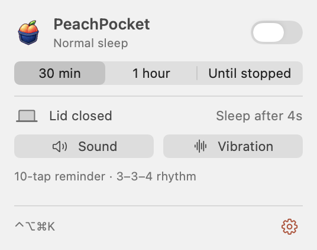
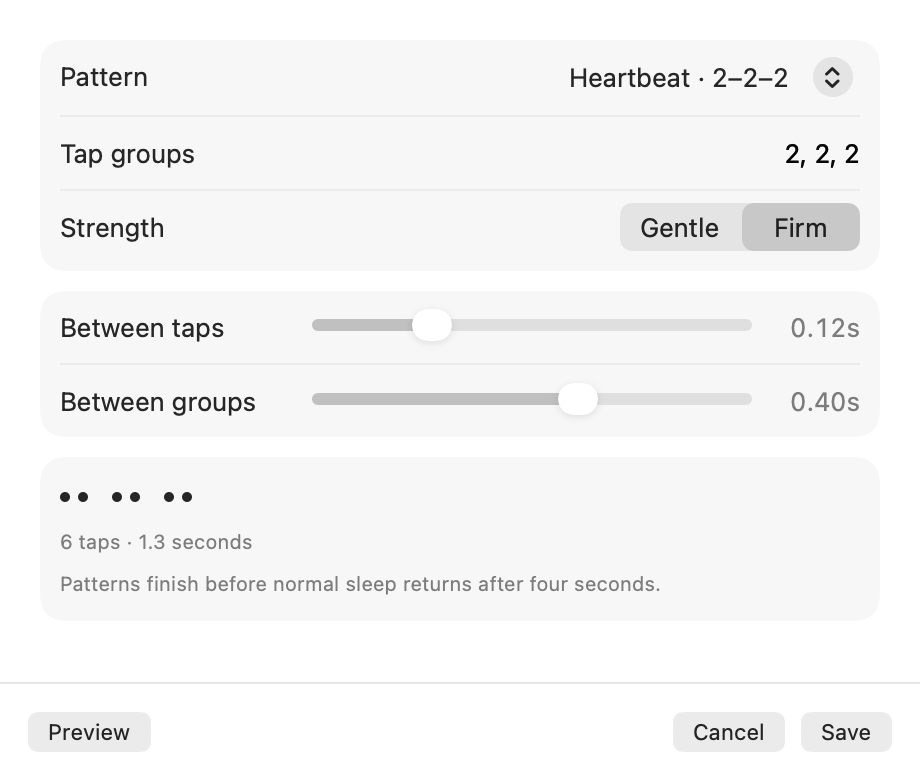

<p align="center">
  
</p>

# PeachPocket

A tiny native macOS menu-bar app that keeps your Mac awake and gives you a physical nudge when you close the lid.

- Toggle from anywhere with **Control + Option + Command + K**.
- Stay awake for 30 minutes, one hour, or until stopped.
- Play a sound and a customizable trackpad rhythm when the lid closes.
- Restore normal sleep after the lid stays closed for four seconds.
- Set up the helper once through macOS Installer, with Touch ID when available. Daily toggles need no password.



## Build and run

Requires macOS 14 or later and Xcode Command Line Tools. Physical vibration requires a supported Force Touch trackpad. There are no third-party package dependencies.

```sh
sh build.sh
open build/PeachPocket.app
```

Click the peach pocket in the menu bar, choose **Enable PeachPocket…**, and finish the one-time helper installation. macOS controls whether Touch ID or a password is required. The menu-bar pocket is outlined at rest and filled while awake. The full-color pixel-art logo and app icon use PeachPocket’s own peach-in-pocket composition, with rendering inspired by [LemonCute](https://lemoncute.com).

These are local, ad-hoc-signed builds, not notarized releases. The build script uses the current machine's architecture.

## Choose a vibration pattern

Open **gear → Vibration pattern…**. Choose Knock, Steady, Heartbeat, or edit your own groups, such as `2, 2, 3`. Adjust the spacing between taps and groups, then select Gentle or Firm strength.

**Preview** plays the draft without saving. **Save** remembers the pattern across launches. **Cancel** or closing the window discards the draft.

Patterns support up to 24 taps and 2.8 seconds so playback fits before the four-second sleep safeguard. The default is ten taps in a 3–3–4 rhythm.



**Sound** previews the audio separately. Alerts use the Mac speakers by default; the gear menu can select the current audio output instead. Volume and mute are respected. The app reports muted speakers and playback errors.

## Sleep control and recovery

An authorized session sets `pmset -a disablesleep 1`. The helper restores `pmset -a disablesleep 0` when:

- You stop the session or its timer expires.
- The lid remains closed for four seconds, or the lid sensor becomes unavailable.
- The app's bridge disconnects, or its heartbeat stalls for ten seconds.
- The helper restarts with an unfinished session recovery record.

Reopening during the lid-close grace period continues the session. The app also requests restoration if macOS reports serious or critical thermal pressure.

If another tool disabled sleep first, PeachPocket offers **Restore sleep** before starting a protected session. Manual recovery is:

```sh
sudo pmset -a disablesleep 0
```

Restoring normal sleep lets macOS apply its usual policy; other apps and external displays can still affect whether the machine sleeps. End the session before putting the Mac in a bag. This utility is not a guarantee against overheating.

### Permissions

The root helper accepts only fixed sleep-control operations from the installing user's signed bridge. It does not execute caller-provided shell commands. The bridge uses XPC; the app communicates with it over pipes. The helper's timer is dormant outside sessions and recovery attempts.

Existing installations retain their internal `local.lidlight.*` service and app identifiers to preserve helper authorization and saved settings. The app, installer, icons, and repository use PeachPocket.

Installed files:

- `/Library/PrivilegedHelperTools/local.lidlight.helper`
- `/Library/LaunchDaemons/local.lidlight.helper.plist`
- `/Library/PrivilegedHelperTools/local.lidlight.session` during a session or pending recovery

Use **gear → Remove helper…** to uninstall with administrator approval. Installation is scoped to the installing user; this is not a multi-user service.

UI/icon rebuilds reuse `build/bridge-cache` and preserve authorization. Changing bridge/protocol code or deleting that cache requires a helper update. Install helper implementation changes through **Update helper…** too.

### Trackpad compatibility

Physical vibration uses Apple's **private MultitouchSupport framework**, isolated in a separate user process. It may stop working after a macOS update or if the trackpad powers down. The actuator's successful return means the command was accepted, not that it was necessarily felt. Audio is a separate reminder, and sleep restoration runs independently in the helper.

## Code layout

| Path | Responsibility |
| --- | --- |
| `Sources/` | SwiftUI/AppKit interface, pattern editor, reminders, helper client, and models |
| `Sources/Mark.swift` | Logo loading and monochrome menu-bar states |
| `Assets/Icon/` | Generated pixel-art logo, generation prompt, and small menu-bar vectors |
| `Helper/main.swift` | Privileged sleep-control daemon and recovery |
| `Bridge/main.swift` | Stable signed XPC client |
| `Native/Haptic.c` | Isolated physical trackpad actuator |
| `Tests/` | Policy, pattern, input-validation, and live bridge checks |

## Verify

```sh
sh test.sh
sh build.sh
codesign --verify --deep --strict build/PeachPocket.app
```

The default tests do not change power settings or actuate the trackpad. After installing the helper, opt into live checks:

```sh
ruby Tests/BridgeSmoke.rb
ruby Tests/BridgeSmoke.rb --exercise-session
ruby Tests/BridgeSmoke.rb --exercise-disconnect
ruby Tests/PeerAuthentication.rb
```

The peer-authentication check confirms that the helper rejects a differently signed client from the same user. It does not change power settings.

The session checks refuse to replace an existing awake session. They use five-second-capped sessions and verify explicit stop or disconnection recovery.

Developer rendering and package checks:

```sh
build/PeachPocket.app/Contents/MacOS/PeachPocket --render-preview "$PWD/build"
build/PeachPocket.app/Contents/MacOS/PeachPocket --installer-check "$PWD/build"
sh -n build/installer-check.sh
```

The preview renders both appearances without starting a session. The installer check builds a local package and emits its postinstall script without executing it. For a physical check, start a session on a desk, close the lid for at least five seconds, reopen it, and verify both the reminder and `SleepDisabled 0` in `pmset -g`.

## License

MIT. See [LICENSE](LICENSE) and [third-party notices](THIRD_PARTY_NOTICES.md).
